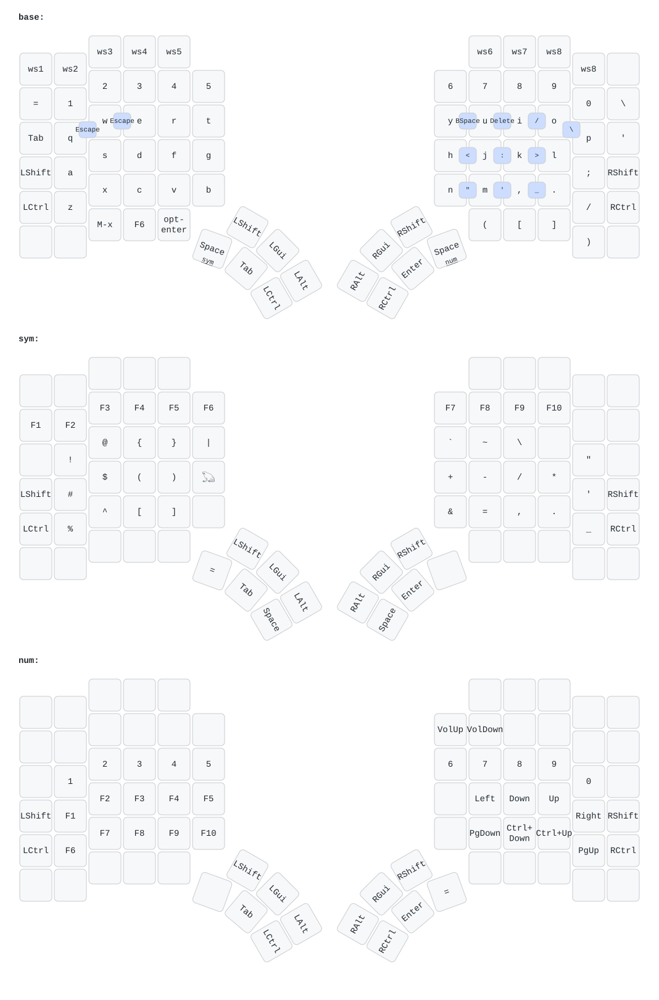

# Rust firmware for the Glove80 keyboard

https://github.com/user-attachments/assets/92c6a0cc-923c-43d2-8932-4119070cfd70

Rusty glove is firmware for the Glove80 split keyboard written in Rust
using the Embassy framework.

## Layout

## Features

- Normal keypresses, mod taps, layers, chords, mouse keys
- Some pretty neopixel animations (that sync between sides, and transition smoothly)

## Wireless

The halves and a USB dongle share an IPv6 network, 6LoWPAN over IEEE 802.15.4.
Key events between the halves, and keyboard reports from the right half to the
dongle, go over UDP: each message is acked, and resent until it is, before the
next one goes (`shared/src/reliable.rs`). Firmware updates go over TCP.
Addresses, ports and the radio settings live in `shared/src/net.rs`.

| node   | address            | UDP                                 | TCP        |
|--------|--------------------|-------------------------------------|------------|
| left   | `fd67:6c76:0:1::1` | 7100 (the right half)               | 7300 (DFU), 7400 (status) |
| right  | `fd67:6c76:0:1::2` | 7100 (the left half), 7200 (dongle) | 7300 (DFU), 7400 (status) |
| dongle | `fd67:6c76:0:1::3` | 7200 (the right half)               | 7300 (DFU), 7400 (status), 7301, 7302, 7401, 7402 on USB |

The dongle is any nRF52840 running the same bootloader as the halves. Set one
up over SWD: `probe-rs erase --chip nRF52840_xxAA`, then `just bootloader`
and `just dongle_flash`. Over USB it's a keyboard, passing on the right half's
reports, and an ethernet adapter. It hands the host an address in
`10.42.0.0/24` over DHCP (without a default route), takes its own updates on
`10.42.0.1:7300`, and forwards `10.42.0.1:7301` and `10.42.0.1:7302` to the
left and right halves' DFU ports. The network stack can't route, so those
forwarded ports are the only way through.

Update with `just left_net`, `just right_net` or `just dongle_net`, which run
`tools/glove-dfu.py`. A device that boots into an update rolls it back on its
next reset unless the script reaches it again to confirm it.

`just status` (or `just status right` etc.) prints each device's status page:
how far behind it's running, whether its key scanner has had to wait, what's
queued, and how its links and radio are doing. The dongle serves its own on
`10.42.0.1:7400` and forwards `7401` and `7402` to the halves'.

## Building

Building is best done using the dev shell of the nix flake, it loads everything in that you need to build the project.

Then use `just both` to invoke the rules in the justfile for producing a `both.uf2` file.

## Keymaps

You can use https://github.com/simmsb/keylayout to generate key layouts (and
also generate previes of them), check out the [one I use](layouts/rusty-glove.kl)
